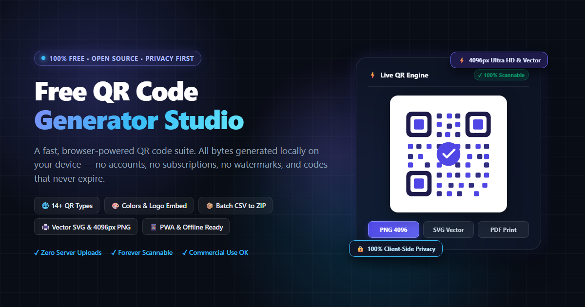

# ⚡ Free QR Code Generator (QRNova)

<p align="center">
  
</p>

<p align="center">
  <strong>The 100% Free, Privacy-First, Browser-Powered QR Code Studio</strong><br>
  No sign-up. No watermarks. No subscriptions. Never expires. All QR bytes generated 100% in your browser.
</p>

<p align="center">
  <a href="https://github.com/arybishal/Free-QR-Code-Generate/stargazers"></a>
  <a href="https://github.com/arybishal/Free-QR-Code-Generate/blob/main/LICENSE"></a>
  <a href="https://nodejs.org">=20" /></a>
  
  
</p>

---

## 📖 Overview

Most commercial QR code generators lock basic features behind aggressive paywalls: they force you to create an account, slap watermark logos on your codes, hold your links hostage on their redirection servers, or charge monthly subscriptions just to download high-resolution print files.

**QRNova (Free QR Code Generator)** is built on the opposite principle:
- **100% Free Forever**: Every feature, format, resolution, and QR type is free for personal and commercial use.
- **Privacy By Design**: **All QR code generation occurs directly inside your browser**. Your WiFi passwords, private URLs, contact vCards, or secret messages are **never transmitted, logged, or stored** on our server.
- **Never Expires**: Encodes data directly into standard static QR codes. Because there is no middleman redirect server, your printed QR codes will work indefinitely — until the physical paper or sign degrades.
- **Production-Ready Quality**: Export true vector **SVG** (infinitely scalable for billboards and packaging), ultra-high-definition **4096px PNG/JPG**, and print-ready **PDF**.

---

## ✨ Useful Features

### 🌐 14+ Built-in QR Code Types
1. **Website (URL)**: Links with auto-correction (`https://`), perfect for menus, portfolios, and marketing.
2. **Plain Text**: Offline notes, model numbers, serial tags, with full UTF-8 support (English, Nepali, Hindi, Arabic, Chinese, Emoji).
3. **WiFi Network**: One-scan join for WPA/WPA2/WPA3, WEP, or open networks with hidden SSID support.
4. **vCard 3.0 Contact**: Digital business card encoding name, organization, phone, email, website, and address straight into iOS/Android contacts.
5. **Email**: Pre-addressed emails with customizable subject lines and body templates.
6. **Phone Number**: Tap-to-call link for fleet stickers, storefront windows, and customer care.
7. **SMS**: Pre-addressed text message with structured keywords for voting, reservations, and orders.
8. **WhatsApp**: Universal `wa.me` chat link with optional pre-filled greeting message.
9. **Location (GPS / Maps)**: Universal `geo:` coordinates that open directions in Google Maps, Apple Maps, or Waze.
10. **Calendar Event (iCal)**: Date, time, venue, and description saved directly to Google Calendar, Apple Calendar, or Outlook.
11. **App Store / Play Store**: Direct install links for iOS App Store and Google Play Store listings.
12. **Social Media Profiles**: Instagram, TikTok, YouTube, X (Twitter), LinkedIn, and Facebook profiles.
13. **UPI & PayPal Payments**: Cashless counter payments via UPI links (`upi://pay`) or PayPal.me handles.
14. **Crypto Wallets**: Plain addresses or BIP-21 payment URIs for Bitcoin (BTC), Ethereum (ETH), and USDT.

### 🎨 Deep Visual Styling & Customization
- **Color Customization**: Set custom foreground and background colors.
- **Real-time Contrast Guard**: Live WCAG contrast ratio calculations warn you if a color combination might fail phone camera scans.
- **Styled Eye Corners**: Customize finder patterns with rounded corners, square edges, or custom module styling.
- **Brand Logo Centerpiece**: Upload custom company or app logos with automatic Error Correction (Level H) switching and safe size boundaries (<=22% width).
- **Live Scannability Score**: Real-time diagnostic meter verifies payload length, quiet zone margins, contrast, and scanner legibility before you print.

### 💾 Versatile Export Formats
| Format | Best For | Capabilities |
| :--- | :--- | :--- |
| **PNG (512px - 4096px)** | Digital displays, presentations, print | Crystal-clear raster with alpha transparency |
| **JPG (512px - 4096px)** | Social media, email attachments | Compact file size with solid background |
| **Vector SVG** | Billboards, packaging, merchandise | Infinite resolution without pixelation |
| **Print-Ready PDF** | Physical print shops, flyers, documents | Formatted vector centered on standard page |

### 📦 Batch QR Generator (CSV to ZIP)
Need 50 table numbers, 200 event badges, or an entire product catalog?
- Upload a standard `.csv` file or paste lines of text into the batch generator.
- Generates all QR codes locally in parallel.
- Bundles everything into a single downloadable `.zip` archive with zero server bandwidth.

### 📱 Progressive Web App (PWA)
- Fully installable on Chrome, Edge, Safari, iOS, and Android.
- Operates offline via Service Worker caching.
- Zero external runtime CDNs: all dependencies (`qrcode-generator`, `jspdf`, `jszip`) are self-hosted.

---

## 🚀 How to Use It

### 1. Generating a Single QR Code
1. Open the homepage or select a specific QR type from the top navigation (e.g. WiFi, Contact, WhatsApp).
2. Enter your details in the form. The live QR code updates instantaneously as you type.
3. *(Optional)* Click **Style & Quality** to customize colors, add your brand logo, or adjust error correction levels.
4. Select your export format (**PNG 1024px**, **Ultra HD 4096px**, **Vector SVG**, or **Print PDF**).
5. Click **Download** and test-scan with your mobile device camera!

### 2. Generating Batch QR Codes
1. Navigate to `/batch-qr-code-generator`.
2. Paste multiple links/values (one per line) or upload a CSV file.
3. Choose your desired output dimensions.
4. Click **Generate & Download ZIP** to receive all codes packed into a single zip file.

---

## 🛠️ Technology Stack & Architecture

- **Backend / Server**: Node.js 20+, Express 4, EJS Templates, Helmet (Strict CSP), Compression, Express Rate-Limit.
- **Rendering Engine**: Client-side Canvas + Vector SVG generators.
- **Packaging & Vendors**: Self-hosted `qrcode-generator`, `jspdf` (lazy-loaded on PDF export), `jszip`.
- **Styling**: Modern Vanilla CSS with dark/light auto-theming and glassmorphic UI. Zero heavy CSS frameworks.
- **Bundle Size**: Core compressed JS bundle under **12 KB gzip** (well below the 150 KB budget).

---

## 🔍 Comprehensive SEO Architecture

This project is built from the ground up for maximum search engine visibility and top Lighthouse scores:

- **Semantic HTML5 & Schema.org**:
  - `WebApplication` schema for rich search snippet indexing.
  - `FAQPage` schema on the homepage and every individual type landing page.
  - `BreadcrumbList` schema across all interior pages.
- **Dynamic Meta Tags**:
  - Open Graph tags (`og:title`, `og:description`, `og:image`, `og:url`, `og:site_name`, `og:type`).
  - Twitter Card `summary_large_image` tags with high-res 1200x630 social banners.
  - Full search engine directives: `index, follow, max-snippet:-1, max-image-preview:large`.
  - Rich targeted keyword matrices tailored for every QR type.
- **XML Sitemap & Robots.txt**:
  - Fully automated, dynamic `/sitemap.xml` listing all landing pages.
  - Clean `/robots.txt` configuration pointing web crawlers directly to the sitemap.
- **Static Site Generation (SSG)**:
  - Supports static export (`npm run export-static`), outputting pre-rendered HTML files for instant TTFB on edge networks.

---

## 🚢 How to Deploy

### Option 1: Static Export (Cloudflare Pages / Netlify / Vercel / GitHub Pages)
Because QRNova executes all QR algorithms in the client's browser, you can export the entire application as pure static HTML/CSS/JS:

```bash
# 1. Install dependencies and build minified assets
npm install
npm run build

# 2. Export all routes into the dist/ directory
npm run export-static
```

Deploy the generated `dist/` directory directly:
- **Cloudflare Pages**: Set build command `npm run build && npm run export-static` and output directory `dist`.
- **Netlify**: Set build command `npm run build && npm run export-static` and publish directory `dist`.
- **Vercel**: Set output directory to `dist`.

---

### Option 2: Node.js Host (Render / Railway / Fly.io / Heroku)
1. Fork or clone this repository.
2. In your cloud dashboard, set:
   - **Build Command**: `npm install && npm run build`
   - **Start Command**: `npm start`
   - **Environment Variables**:
     ```env
     NODE_ENV=production
     USE_MIN=1
     PORT=3000
     SITE_URL=https://your-domain.com
     BRAND_NAME=QRNova
     CONTACT_EMAIL=contact@your-domain.com
     COUNTRY=YourCountry
     ```

---

### Option 3: Self-Hosted VPS (PM2 + Nginx on Ubuntu/Debian)

#### 1. Clone & Build
```bash
git clone https://github.com/arybishal/Free-QR-Code-Generate.git /var/www/qrnova
cd /var/www/qrnova
npm install
npm run build
```

#### 2. Configure Environment
```bash
cp .env.example .env
nano .env # update SITE_URL, BRAND_NAME, CONTACT_EMAIL
```

#### 3. Run with PM2
```bash
npm install -g pm2
pm2 start server.js --name "qrnova" --env USE_MIN=1
pm2 save
pm2 startup
```

#### 4. Configure Nginx Reverse Proxy
```nginx
server {
    listen 80;
    server_name your-domain.com www.your-domain.com;
    return 301 https://$host$request_uri;
}

server {
    listen 443 ssl http2;
    server_name your-domain.com;

    # SSL certificates (Let's Encrypt)
    ssl_certificate /etc/letsencrypt/live/your-domain.com/fullchain.pem;
    ssl_certificate_key /etc/letsencrypt/live/your-domain.com/privkey.pem;

    # Immutable cache for static vendor assets
    location /vendor/ {
        proxy_pass http://127.0.0.1:3000/vendor/;
        proxy_cache_valid 200 365d;
        add_header Cache-Control "public, max-age=31536000, immutable";
    }

    location / {
        proxy_pass http://127.0.0.1:3000;
        proxy_http_version 1.1;
        proxy_set_header Upgrade $http_upgrade;
        proxy_set_header Connection 'upgrade';
        proxy_set_header Host $host;
        proxy_set_header X-Real-IP $remote_addr;
        proxy_set_header X-Forwarded-For $proxy_add_x_forwarded_for;
        proxy_set_header X-Forwarded-Proto $scheme;
        proxy_cache_bypass $http_upgrade;
    }
}
```

---

### Option 4: Docker & Docker Compose
Create a `Dockerfile`:
```dockerfile
FROM node:20-alpine
WORKDIR /app
COPY package*.json ./
RUN npm ci --omit=dev
COPY . .
RUN node scripts/build.js
ENV PORT=3000 USE_MIN=1 NODE_ENV=production
EXPOSE 3000
CMD ["node", "server.js"]
```

Build and run:
```bash
docker build -t qrnova .
docker run -d -p 3000:3000 --name qrnova-app qrnova
```

---

## 💻 Local Development

```bash
# Clone the repository
git clone https://github.com/arybishal/Free-QR-Code-Generate.git
cd Free-QR-Code-Generate

# Install dependencies (copies self-hosted vendor files)
npm install

# Run development server with live reload
npm run dev

# Run unit tests (payload encoders)
npm test

# Run engine smoke tests (UTF-8, escaping, length limits)
npm run smoke

# Build minified assets and run asset budget verification
npm run build

# Render social Open Graph banner cover
npm run cover
```

---

## 📁 Repository Structure

```
.
├── assets/
│   └── cover.png              # High-resolution graphic cover banner
├── content/
│   └── types.js               # Single source of truth: 14+ types, copy, FAQs, metadata
├── public/
│   ├── css/                   # Stylesheets (Vanilla CSS + minified versions)
│   ├── js/
│   │   ├── app.js             # Client-side QR generator & styling engine
│   │   ├── batch.js           # CSV to ZIP batch processing logic
│   │   ├── qr-payloads.js     # Pure payload formatting utilities
│   │   └── ui.js              # Theme switcher & navigation controls
│   ├── vendor/                # Self-hosted libraries (qrcode, jspdf, jszip)
│   ├── cover.png              # Social banner
│   ├── og-cover.png           # 1200x630 Open Graph cover card
│   ├── icon-192.png           # PWA 192px icon
│   ├── icon-512.png           # PWA 512px icon
│   ├── icons.svg              # Vector favicon
│   ├── manifest.webmanifest   # Web App Manifest
│   └── sw.js                  # Service Worker for offline capability
├── scripts/
│   ├── build.js               # Asset minifier & gzip budget auditor
│   ├── cover-template.html    # Graphic cover template
│   ├── generate-cover.js      # Headless browser cover image generator
│   ├── export.js              # Full static site exporter
│   ├── icons.js               # Pure-Node raster PNG generator
│   ├── qr-smoke.js            # Comprehensive engine test suite
│   └── vendor.js              # Copies runtime libraries from node_modules
├── tests/
│   └── payloads.test.js       # Jest unit tests for payloads
├── views/
│   ├── partials/
│   │   ├── head.ejs           # SEO tags, OpenGraph, JSON-LD, navbar
│   │   ├── foot.ejs           # Footer, theme controls, service worker init
│   │   └── generator.ejs      # Reusable interactive QR generator card
│   ├── 404.ejs                # Not found page
│   ├── home.ejs               # Homepage marketing + hero generator
│   ├── simple.ejs             # About, Privacy, Terms, Contact, How-it-works, FAQ
│   └── type.ejs               # Dedicated SEO landing pages for each QR type
├── .env.example               # Environment variables template
├── .gitignore                 # Excluded files & directories
├── package.json               # Node.js manifest and scripts
├── README.md                  # Project documentation
└── server.js                  # Express.js HTTP application server
```

---

## 🛡️ License & Credits

- **License**: Released under the [MIT License](LICENSE).
- **Author**: Created with ❤️ by [Bishal Aryal](https://github.com/arybishal).
- **Notice**: "QR Code" is a registered trademark of DENSO WAVE INCORPORATED.
